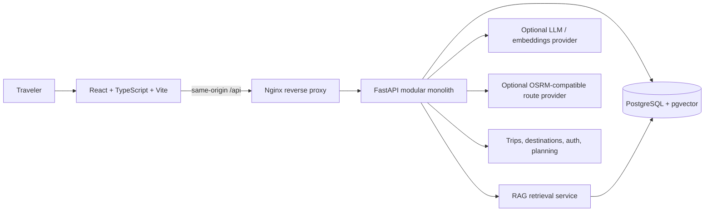

# Yatranook — Production-Oriented Full-Stack Starter

Yatranook is an AI-assisted tourism discovery and trip-planning platform initially focused on Odisha, India. This repository combines the existing React frontend starter with a FastAPI backend, PostgreSQL, pgvector-backed tourism document storage, authentication foundations, route preview logic, Docker Compose, migrations, seed data, and tests.

> **Implementation status:** This is a production-oriented engineering baseline, not a fully launched commercial travel service. The core API, database schema, Docker packaging, seed catalogue, fallback planner, optional OpenAI-compatible LLM/RAG path, JWT auth endpoints, saved-trip endpoints, and route-preview endpoint are included. Live booking, real fare data, production geocoding, a contracted routing SLA, verified tourism ingestion, email verification, password reset, refresh-token rotation, and operational hosting/TLS still require provider setup and further implementation. No booking is performed by this code.

## Architecture



The frontend is served by Nginx in the production container. Nginx proxies `/api/*` to FastAPI, avoiding a separate browser-facing API origin. PostgreSQL is internal to the Docker network apart from a loopback-only development port mapping.

## Quick start with Docker Compose

Requirements: Docker Engine/Desktop with the Compose plugin.

### 1. Create local environment file

Linux/macOS:

```bash
cp .env.example .env
```

Windows PowerShell:

```powershell
Copy-Item .env.example .env
```

For local development, the defaults are intentionally marked development-only. Before any public deployment, generate unique secrets and configure the domain settings described below. Use URL-safe hexadecimal strings for database passwords because Compose builds the connection URL from the environment values.

### 2. Start the local development stack

```bash
docker compose -f compose.yaml -f compose.dev.yaml up --build -d
```

The API container waits for PostgreSQL to become healthy, applies Alembic migrations, inserts the initial destination catalogue idempotently, and starts FastAPI. The web container serves the production Vite build.

### 3. Open the application

- Frontend: <http://localhost:8080>
- API health through Nginx: <http://localhost:8080/api/v1/health>
- API docs in development mode: <http://localhost:8080/docs>
- PostgreSQL: `localhost:5432` (development override only; bound to loopback)

Useful commands:

```bash
docker compose -f compose.yaml -f compose.dev.yaml ps
docker compose -f compose.yaml -f compose.dev.yaml logs -f api
docker compose -f compose.yaml -f compose.dev.yaml logs -f web
docker compose -f compose.yaml -f compose.dev.yaml logs -f db
docker compose -f compose.yaml -f compose.dev.yaml down
```

To stop containers and preserve database data, run `docker compose -f compose.yaml -f compose.dev.yaml down`. To destroy the database volume as well (irreversible), run `docker compose -f compose.yaml -f compose.dev.yaml down -v`.

Before the first public release, generate and commit dependency lockfiles using the approved package managers (`uv lock` in `apps/api` and `npm install` in `apps/web`). This archive was prepared in an environment where package registries could not be resolved, so it includes version ranges rather than generated `uv.lock` and `package-lock.json` files. Docker currently resolves frontend dependencies during image build; pin them with a committed lockfile before production releases.

## Local development without the web container

Run PostgreSQL first:

```bash
docker compose -f compose.yaml -f compose.dev.yaml up -d db
```

Backend (from `apps/api`):

```bash
uv sync --extra dev
uv run alembic upgrade head
uv run python -m app.db.seed
uv run uvicorn app.main:app --reload --host 127.0.0.1 --port 8000
```

The API includes an `apps/api/.python-version` pin for Python 3.12. If an existing
virtual environment was created with another interpreter, run `uv sync --extra dev`
from `apps/api` to recreate it before starting the server.

Frontend (from `apps/web`):

```bash
npm install
Copy-Item .env.example .env.local  # Windows PowerShell
npm run dev
```

For bash, use `cp .env.example .env.local`. The local frontend environment points to `http://localhost:8000`.


## Production Compose deployment baseline

The base `compose.yaml` keeps PostgreSQL and FastAPI private and does not publish database/API ports. Local port publishing is isolated in `compose.dev.yaml`. A production deployment uses `compose.production.yaml`, which requires explicit secrets and connects the web service to an externally managed TLS ingress network.

1. Copy `.env.production.example` to `.env.production` and replace every placeholder. Generate values with:

   ```bash
   python -c "import secrets; print(secrets.token_hex(24))"  # POSTGRES_PASSWORD
   python -c "import secrets; print(secrets.token_hex(32))"  # JWT_SECRET
   ```

2. Create the shared network used by your HTTPS ingress (once):

   ```bash
   docker network create edge
   ```

3. Start the application stack:

   ```bash
   docker compose --env-file .env.production -f compose.yaml -f compose.production.yaml up --build -d
   ```

4. Configure your TLS ingress/reverse proxy to join the `edge` network and forward the public domain to `web:80`. An example Caddy configuration is in `infra/deployment/Caddyfile.example`. Do not expose PostgreSQL or FastAPI directly to the public internet.

5. Verify health and logs, then complete a backup/restore drill before accepting real users. The included Caddyfile is an example configuration, not a deployed TLS service. Keep `.env.production` outside version control. Use a supported Docker Compose v2 release for the production overlay.

This is a production-oriented deployment baseline, not a complete hosted production operation. Configure TLS, durable backups, alerting, log retention, secret rotation, database maintenance, and incident procedures for the chosen hosting provider.

## Environment configuration

All secrets belong in the root `.env` file or a deployment secret manager. Never commit `.env`.

| Variable | Purpose |
|---|---|
| `APP_ENV` | `development` or `production` |
| `POSTGRES_DB`, `POSTGRES_USER`, `POSTGRES_PASSWORD` | Database bootstrap credentials |
| `JWT_SECRET` | JWT signing secret; production requires a unique value of at least 32 characters |
| `CORS_ORIGINS` | Allowed browser origins when frontend and API are served separately |
| `ALLOWED_HOSTS` | Comma-separated API Host header allowlist in production |
| `OLLAMA_BASE_URL` | Ollama server URL, normally `http://localhost:11434` locally |
| `OLLAMA_CHAT_MODEL` | Installed Ollama chat model, for example `llama3.2:3b` |
| `OLLAMA_EMBEDDING_MODEL` | Installed Ollama embedding model; its output must match the configured vector dimension |
| `EMBEDDING_DIMENSIONS` | Must remain 1536 for the initial migration |
| `OSRM_BASE_URL` | Optional OSRM-compatible routing endpoint; leave empty for geographic preview only |
| `WEB_PORT` | Public local port for Nginx |

### Production environment requirements

Before deploying to a public domain:

1. Set `APP_ENV=production`.
2. Set `JWT_SECRET` to a cryptographically random secret (at least 32 characters; do not use the example value). Generate one with `python -c "import secrets; print(secrets.token_hex(32))"`.
3. Set `POSTGRES_PASSWORD` to a unique strong URL-safe password. Generate one with `python -c "import secrets; print(secrets.token_hex(24))"`.
4. Set `ALLOWED_HOSTS` to the actual API host names (for same-origin web proxying, include the public domain and any health-check host required by your platform).
5. Configure TLS/HTTPS at a trusted reverse proxy or load balancer.
6. Configure `CORS_ORIGINS` only for the actual frontend origins if cross-origin access is needed.
7. Use managed secrets; do not bake secrets into images.
8. Configure managed PostgreSQL or a durable encrypted volume, automated backups, restore drills, metrics, alerts, and log retention.
9. Keep API and database ports private; expose only HTTPS through the ingress layer.
10. Configure OpenAI-compatible and routing providers only after reviewing their terms, costs, rate limits, and data-handling policies.

The included Nginx container is a simple HTTP application reverse proxy. It is not a complete TLS termination or public-edge security configuration.

## API overview

Base path: `/api/v1`

| Method | Endpoint | Authentication | Purpose |
|---|---|---|---|
| GET | `/health` | Public | API and database health |
| GET | `/health/live` | Public | Process liveness |
| POST | `/auth/register` | Public | Register account |
| POST | `/auth/login` | Public | Obtain bearer access token |
| GET | `/auth/me` | Bearer | Current user |
| GET | `/destinations` | Public | Search seed/catalogue destinations |
| GET | `/destinations/{id}` | Public | Destination details |
| POST | `/assistant/plan` | Public | Generate a grounded plan suggestion/fallback |
| POST | `/assistant/chat` | Public | Continue a grounded natural-language travel conversation |
| POST | `/routes/optimize` | Public | Geographic stop-order preview; optional OSRM route data |
| GET | `/trips` | Bearer | List current user's saved trips |
| POST | `/trips` | Bearer | Save a trip |
| GET | `/trips/{id}` | Bearer | Get a saved trip owned by current user |
| DELETE | `/trips/{id}` | Bearer | Delete a saved trip owned by current user |

Interactive API documentation is available at `/docs` when `APP_ENV=development`.

## AI and RAG behavior

- The assistant uses Ollama's native `/api/chat` and `/api/embed` endpoints. Install and run Ollama locally, then pull the configured models with `ollama pull qwen2.5-coder:3b` and `ollama pull nomic-embed-text`. The default chat model is chosen because it returns concise answers without exposing a reasoning trace.
- If Ollama is unavailable, the assistant uses a deterministic fallback response and the destination catalogue. It does not claim live AI results.
- `POST /assistant/chat` accepts the current trip context, a message, and recent conversation history. It returns grounded destination suggestions, retrieved sources, and explicit warnings when live fares or road routes are unavailable.
- Tourism documents can be ingested from JSONL using `uv run python -m scripts.ingest_documents path/to/file.jsonl` from `apps/api`.
- Documents should include `title`, `content`, `source_name`, optional `source_url`, and optional `metadata`.
- The ingestion script stores embeddings when the configured Ollama embedding model is available; otherwise, it stores text for keyword retrieval. The initial pgvector migration requires 1536-dimensional embeddings, so models with another output size intentionally use keyword retrieval.
- Only ingest content you have permission to store. Curate and verify source quality before displaying it as reliable travel guidance.
- Retrieval does not guarantee factual correctness. The assistant is instructed not to invent current prices, hours, routes, availability, or booking confirmations.

## Routing behavior

`POST /api/v1/routes/optimize` uses a nearest-neighbor geographical ordering as a preview. This is **not** a road route and its straight-line distance is not driving distance. If `OSRM_BASE_URL` is configured, the service requests an OSRM-compatible driving route for the proposed stop order and returns provider distance/duration/geometry. Cheapest-route comparisons still require current fare data; no unsupported fare is invented.

## Database and migrations

The database image includes pgvector. The initial Alembic migration creates users, destinations, tourism documents, trips, and the `vector` extension.

From `apps/api`:

```bash
uv run alembic current
uv run alembic history
uv run alembic upgrade head
uv run alembic downgrade -1  # only in a controlled non-production environment
```

Do not edit an already-applied migration; create a new revision. For multi-replica production, run migrations as a one-off release job rather than letting every API replica migrate on startup.

## Tests and quality checks

Backend (from `apps/api`):

```bash
uv sync --extra dev
uv run pytest
uv run ruff check .
uv run ruff format --check .
```

Frontend (from `apps/web`):

```bash
npm install
npm run typecheck
npm run lint
npm run test
npm run build
```

Browser tests:

```bash
npx playwright install chromium
npm run e2e
```

The current automated backend unit tests cover low-budget validation, route geometry ordering, and token/password primitives. Database-backed integration tests and full real-provider E2E tests should be added as provider contracts and staging services are configured.

## Backups

Use a tested backup process for production. Basic local backup/restore examples are in `scripts/backup.sh` and `scripts/restore.sh`. Do not rely on a backup until you have successfully restored it into an isolated database and verified the application can read the restored data.

## Repository structure

```text
Yatranook-Production/
├── apps/
│   ├── web/                 # React + TypeScript frontend
│   └── api/                 # FastAPI modular monolith
├── infra/nginx/             # Reverse proxy reference configuration
├── scripts/                 # Backup and operational scripts
├── docs/                    # Architecture, security, runbooks
├── compose.yaml
├── compose.dev.yaml
├── compose.production.yaml
├── infra/deployment/
├── .env.example
├── .env.production.example
└── README.md
```

## What is not complete yet

This repository establishes an end-to-end foundation and first API integration, but it does not claim the entire product vision is complete. Before a real public launch, implement and validate production user lifecycle (email verification, password reset, refresh/revocation), rate limiting and abuse monitoring, admin-controlled tourism source curation, real geocoding and route-provider contracts, live transport/accommodation pricing, provider booking/checkout integration, notification delivery, privacy/legal notices, database-backed integration testing, TLS ingress, and production restore/incident drills.
