# Yatranook — Architecture and Engineering Blueprint

**Project:** Yatranook  
**Product concept:** AI-driven intelligent tourism assistant for Odisha  
**Status:** Architecture and delivery plan based on supplied concept documents; no implementation is evidenced in the workspace.  
**Prepared:** 30 October 2026

## 1. Executive summary

Yatranook is proposed as a responsive web product that helps visitors discover Odisha destinations, understand cultural context, and assemble practical, personalized trip plans. Its core workflow is intended to combine structured trip preferences, curated destination knowledge, source-aware AI responses, and deterministic checks for known time, budget, and access constraints. Weather, routes, transport, and visitor-status information are optional inputs whose availability and freshness must be shown. The product should disclose assumptions and uncertainty rather than present estimates as verified facts.

The supplied documents consistently describe React with Tailwind CSS, Python/FastAPI, PostgreSQL with pgvector, an LLM and embeddings, and optional maps/weather integrations. They describe a proposed design and roadmap, not a deployed product. The workspace has no app source files, requirements, migrations, tests, deployment configuration, or data files; implementation status is therefore **unverified and not demonstrated**.

The best initial architecture is a **modular monolith**: one web frontend, one FastAPI application organized around clear domain/service boundaries, one PostgreSQL database (pgvector only if retrieval evaluation justifies it), and provider adapters. Run asynchronous ingestion as a command or scheduled task initially. Avoid microservices, Kubernetes, booking/payment integration, user accounts, voice, and expensive live-data dependencies until research or operational evidence requires them.

The first meaningful release should support destination search, evidence-grounded tourism Q&A, and draft itineraries with transparent budget/time assumptions and constraint checks. Its production baseline includes access controls appropriate to the actual data, secure secret handling, source provenance, privacy and retention rules, structured logs, rate limits, tested failure paths, backups with a demonstrated restore, and a deployment/rollback procedure.

### Architecture assessment

| Area | Documented design | Gap / risk | Recommended action | Priority |
|---|---|---|---|---|
| Frontend | React + Tailwind responsive web interface, chat, search, itinerary/map views (Abstract pp. 10, 14; Supporting Document p. 11) | No screens, interaction states, API contracts, accessibility criteria, or code are supplied | Prototype the request → evidence → itinerary journey; define keyboard, responsive, loading, empty, stale-data, and error states | P0 |
| Backend | FastAPI REST, validation, session/trip context, search and itinerary services | No repository, schema, auth decision, route list, rate limits, or lifecycle behavior | Implement one versioned API and modular monolith; document contracts and request limits | P0 |
| AI / RAG | LLM + embeddings, retrieved sources, citations, uncertainty; deterministic planning checks | Provider/model, prompt, evaluation set, thresholds, injection defenses, and costs are unspecified | Keep AI provider behind an adapter; enforce structured output and evidence references; evaluate against reviewed cases | P0 |
| Database | PostgreSQL + pgvector; destination/source/chunk/itinerary/preference data | No schemas, migrations, retention, access model, backup plan, or vector necessity evidence | Begin with relational schema and text/metadata search; add pgvector after retrieval tests show value | P0 |
| External integrations | Optional maps, weather, tourism and visitor/transport sources | No vendor, access, licensing, freshness guarantee, quotas, or test credentials | Select providers only after terms/coverage review; use adapters, timeouts, provenance, and unavailable states | P1 |
| Security / privacy | Input validation, secret protection, minimization, retention, emergency safeguards | No threat model, account scope, authorization model, or data classification | Minimize stored personal data; set retention and redaction rules; threat-model endpoints and ingestion | P0 |
| Testing / operations | Pytest, API tests, Docker, CI/CD, monitoring are proposed | No tests, target thresholds, environment model, telemetry, restore or rollback evidence | Define release gates before implementation; add CI, health checks, observability and restore rehearsal | P0 |

## 2. Source inventory and review coverage

| Source | Review coverage | What it establishes | Evidence limit |
|---|---|---|---|
`Yatranook_Supporting_Document.pdf` | All 14 pages text-reviewed; architecture and workflow figures on pp. 6–7 visually inspected | Proposed problem, FR-01–FR-10, proposed architecture, RAG, data, integrations, privacy, tech, phased roadmap, testing, risks and references | Explicitly says concept/proposal; user pain points, integrations, results, and deployment are unverified |
`Yatranook_Abstract.pdf` | All 17 pages text-reviewed; key workflow/architecture/technology/roadmap/evaluation pages reviewed | Concise product framing, personas, capabilities, layered reference design, example, implementation phases and evaluation measures | Explicitly labels capabilities as proposed and no implementation, deployment, performance, or user validation as claimed |
`Yatranook_Architecture.png` | Supplied image visually reviewed | Detailed A–H conceptual layers and interactions: UX, FastAPI, AI/RAG, data, providers, trust/reliability, workflow, roadmap | Diagram is not evidence that components exist or providers are connected |
Workspace | Root and visible files inspected; Git state checked conceptually (empty project root apart from `.git`) | No application implementation was present in the supplied workspace at review time | No application behavior can be confirmed |

The supporting document calls the concept “YatraAI Odisha” in some places while naming the project Yatranook. The abstract and architecture image use Yatranook. Recommendation: standardize all user-facing and code identifiers on **Yatranook**; retain “YatraAI Odisha” only when quoting the source material.

## 3. Consolidated requirements and evidence labels

Labels used throughout: **Documented** means stated in supplied files; **Inferred** means needed to make the documented workflow coherent; **Recommended** means a proposed engineering choice; **Unverified** means the documents do not establish it.

### Functional inventory

| ID / priority | Capability, user and purpose | Inputs → processing → outputs | Dependencies / entities / API | Main failure and acceptance intent | Release |
|---|---|---|---|---|---|
| FR-01 / P0 | Destination discovery for travelers; search by district, region, interests and available metadata (**Documented**) | Query and filters → validated filter/search → ranked destination summaries with evidence | Destination, Source; `GET /api/v1/destinations` | Empty/incomplete index → honest empty result; test supported filters, stable pagination, and source metadata on returned facts | MVP |
| FR-02 / P0 | Conversational tourism Q&A with relevant session/trip context (**Documented**) | Question + optional trip context → retrieve evidence → generate bounded response → answer with sources and uncertainty | Conversation/TripContext, Source, Chunk; `POST /api/v1/assistant/turns` | No/weak evidence, LLM/provider failure → disclose and avoid invented specifics; reviewed test set verifies claim-to-source support | MVP |
| FR-03 / P0 | Clarify missing essential trip information (**Documented**) | Partial request → identify required unknowns based on task → ask a focused question | TripRequest; same assistant endpoint | Ambiguity mistaken as fact → clarify; acceptance tests verify missing origin/date/budget handling is task-dependent, not arbitrary | MVP |
| FR-04 / P0 | Retrieve curated destination records and tourism passages before factual generation (**Documented**) | Query → metadata filters + lexical/vector retrieval → ranked evidence bundle | Source, Document, Chunk, embedding; internal retrieval service | Stale or irrelevant retrieval → mark evidence state and abstain; retrieval benchmark has reviewed questions and expected sources | MVP |
| FR-05 / P0 | Generate personalized day-wise itinerary draft and alternatives (**Documented**) | Origin, dates/duration, interests, budget, pace/must-visits → candidate ranking, schedule → draft with assumptions | Itinerary, Stop, Destination, Evidence; `POST /api/v1/itineraries` | Sparse data or infeasible trip → alternatives/trade-off; scenarios verify output schema and no hidden guarantees | MVP |
| FR-06 / P0 | Check known time, budget, opening/access constraints (**Documented**) | Draft + known limits → deterministic checks and totals → pass/warn/fail issues | Itinerary, Stop, CostAssumption, ProviderObservation; internal validator | Unknown treated as confirmed → show unknown; hard constraints meet predeclared test thresholds or return infeasible | MVP |
| FR-07 / P0 | Show source title/link and last verified/retrieved time (**Documented**) | Evidence references → attach provenance/freshness → render source labels | Source, Evidence; returned in assistant/itinerary response | Broken or irrelevant citation → report/source excluded; human review verifies each citation supports its claim | MVP |
| FR-08 / P1 | Optional route/weather/visitor data from configured providers (**Documented**) | Location, mode/date → provider adapter → result with timestamp/status | ProviderObservation; `GET /api/v1/routes/estimate`, `GET /api/v1/weather` when provider chosen | Timeout, quota, stale result → explicit unavailable state; mock tests cover timeout/empty/invalid provider responses | Production baseline for any enabled provider; otherwise later |
| FR-09 / P1 | Revise affected itinerary sections while retaining unchanged constraints (**Documented**) | User change → recompute affected stops and validation → versioned draft | ItineraryVersion, Stop; `POST /api/v1/itineraries/{id}/revisions` | Lost constraints/state → preserve prior version and diff; scenario confirms unchanged requirements remain intact | MVP basic revision; saved versions require identity/persistence decision |
| FR-10 / P2 | English, Odia, Hindi language options if quality path supports them (**Documented**) | Locale + query → localized UI/content/answer with review → locale-labeled response | Source language/locale fields; same API locale field | Poor translation/place names → fall back with explicit language status; language-specific human evaluation before claiming support | English MVP; other languages after review |
| F-11 / P2 | Persist account profiles, saved trips, collaboration, reservations or payments (**Unverified**) | Not established | Would require identity, ownership, audit, deletion and provider-specific contracts | Do not build until research and explicit scope; no booking status may be inferred from AI response | Later / decision required |
| F-12 / P1 | Tourism content ingestion and review lifecycle (**Documented as pipeline**) | Approved source → fetch/import → clean/chunk/metadata → index → human review/refresh | Source, Document, Chunk, IngestionRun; admin/CLI workflow (admin API not specified) | Terms/access changes, malformed text, poisoned content → quarantine and record failure; trace each searchable chunk to source and ingestion run | MVP curated import; automated refresh later |
| F-13 / P2 | Feedback, correction and operations reporting (**Inferred/Recommended**) | User feedback or staff finding → review queue → correct/version records | Feedback, Source, AuditRecord; `POST /api/v1/feedback` | Abuse or sensitive data in free text → validation/redaction; every accepted correction has state/owner | MVP lightweight feedback; operations tooling later |

### Non-functional requirements

Documented quality goals (Supporting Document pp. 5, 10–12; Abstract pp. 13, 16) are factuality, source attribution, transparency, resilience, measured latency, security/privacy, maintainability, accessibility, localization quality, and evaluation before claims. No numerical thresholds are supplied. **Set thresholds before running evaluation** and include dataset size, method, date, known bias, and failure examples in results.

Recommended initial acceptance gates: all known hard constraints validated deterministically; no booking/payment side effects; every factual answer claim is either source-linked or explicitly marked as an estimate/unknown; provider failures tested without live paid dependencies; keyboard-accessible core journeys; secrets absent from source/logs; database backup successfully restored in a clean environment before production. Latency, unsupported-claim, citation accuracy, estimate error, and usability thresholds must be agreed before test runs rather than invented here.

## 4. Current architecture assessment and conflicts

### What is sufficiently specified

- The broad product workflow: capture preferences → clarify essential unknowns → retrieve tourism evidence → draft → validate known constraints → present sources/uncertainty → revise (Supporting Document pp. 6–8; Abstract pp. 9–12).
- Conceptual responsibilities of UI, FastAPI, RAG, planning, PostgreSQL/pgvector, and optional providers (Supporting Document p. 6; Abstract pp. 10–11).
- The need for source provenance, freshness distinctions, fallback behavior, and deterministic time/budget checks (Supporting Document pp. 8–10; Abstract pp. 11–13).
- Broad evaluation categories and phased progression from research/data to assistant, itinerary, selected APIs, and evaluation (Supporting Document pp. 11–12; Abstract pp. 15–16).

### Gaps, ambiguities and resolution

| Issue | Evidence / status | Recommendation |
|---|---|---|
| Project naming | “YatraAI Odisha” appears in the supporting document while Yatranook is the supplied project name | Use Yatranook as canonical product and repository name; treat older name as source wording only |
| “Modular services” language | Abstract p. 10 says modular services but depicts layers inside a single application; no independently deployed service boundary is specified | Interpret as modules in a modular monolith at MVP; split services only on measured scaling/team/deployment need |
| Feature breadth vs prototype | Vision includes discovery, Q&A, culture, itinerary, routes, weather, multilingual support and adaptive planning; no scope/time/team specified | MVP: small curated Odisha subset, English, search, grounded Q&A, draft itinerary, deterministic checks, source labels; optional live APIs gated on vendor review |
| “Personalization” and trip context | Inputs named; no identity or persistence decision | Keep context in request/session memory without account requirement initially; disclose session retention; make persistence an explicit later ADR |
| Budget feasibility | Example ₹3,000 split is clearly invented and excludes unknown factors | Treat budget outputs as illustrative ranges only; ask party size, travel-to-destination inclusion, stay and dates; show excluded/unknown categories; never style as quote |
| Route/time feasibility | Route modes, provider and source data absent | Mark route-dependent feasibility as unknown when no provider data; use estimated visit duration only with provenance; deterministic checks must retain uncertainty |
| Live information | Provider classes only; no provider/vendor selected | No hard dependency at launch; adapter contract plus stale/unavailable state; verify terms, coverage, quotas and attribution first |
| RAG/vector search | pgvector proposed but no evaluation demonstrates vector retrieval is needed | Begin with full-text/metadata search and curated records; introduce embeddings/pgvector only if benchmark relevance supports it |
| User accounts, bookings, payment, notifications | Not specified as initial features; examples in master prompt are organizing possibilities | Out of MVP. If later in scope, treat authorization, consent and confirmed/unknown transaction handling as separate design gate |
| Quality thresholds | Metrics are listed but no target values or evaluation results | Agree targets and annotation protocol before testing; report results with limitations, never infer success from architecture |
| Security/operations | Controls mentioned conceptually; no concrete deployment or threat model | Define environment, data classification, secrets, rate limits, logs, retention, backup/restore and rollback before external pilot |
| Research claims | Supporting Document pp. 3–4 and Abstract pp. 3–6 say needs and user segments are hypotheses | Run user interviews and observed planning tasks; select first segment based on evidence, not assumptions |

## 5. Recommended system architecture

### Architecture choice

**Recommended:** monorepo, modular monolith, one REST API, one PostgreSQL instance, a static/deployed React frontend, a background ingestion command/scheduled job, and provider adapters. The concept is early and has no demonstrated independent scaling or deployment needs. This minimizes operational load while preserving boundaries that can later be extracted.

### Layers and responsibilities

1. **Web frontend:** React + Tailwind; route/page modules for discovery, assistant, destination detail, itinerary and evidence; typed API client; accessible controls; no provider secrets or authoritative planning logic in browser.
2. **API/application:** FastAPI `/api/v1`; Pydantic request/response schemas; request ID, input limits, rate limiting; application services coordinate repositories, retrieval, planner, validators, and adapters; consistent typed errors.
3. **Domain/planning:** deterministic domain models and checks for trip duration, stop duration, explicit time windows, budget arithmetic, and missing data. LLM proposes content and candidate explanations; it does not calculate trusted totals, choose permission outcomes, or assert provider status.
4. **AI/RAG:** provider abstraction for chat and embedding models; prompt templates/version; metadata-filtered retrieval; bounded context; structured output schema with evidence IDs; output checks for schema, cited evidence membership, unsupported live-specific claims, and safety/uncertainty state. Treat retrieved text as untrusted data/instructions.
5. **Data/knowledge:** relational source and destination records first; versioned migrations; chunk provenance; optional pgvector extension for semantic search; current observations separate from stable cultural facts; ingestion records and review states.
6. **Integration adapters:** maps/weather/official tourism or verified visitor data only after terms, access, attribution and quality review. Each returns typed result, provider, retrieval time, expiry/freshness, and status. Timeouts and quotas are bounded; cache only where permitted.
7. **Operations/security:** environment-based settings, secret manager or platform environment secrets, redacted structured logs, error reporting/metrics, health/readiness checks, backups and restore rehearsal, migration/rollback runbook, dependency updates and CI gates.

### What belongs in AI vs deterministic code

| Use an LLM for | Use deterministic application logic for |
|---|---|
| Parsing natural language into a candidate structured request; conversational clarification; explaining evidence in natural language; drafting descriptions and itinerary alternatives | Input validation; authorization; source membership and freshness labels; currency arithmetic; duration totals; schedule overlap; hard budget/time checks; provider timeout/status; reservation state if ever added |

### System context diagram

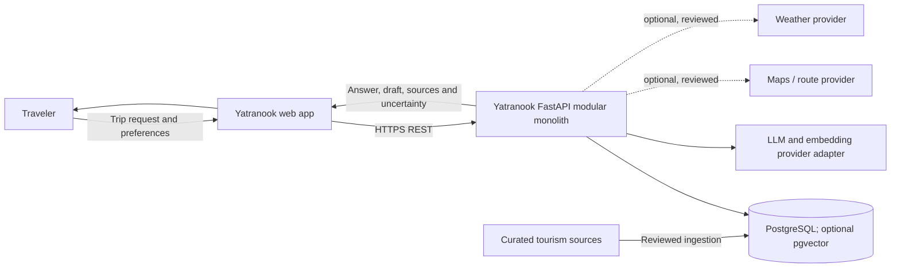

**Flow:** user requests are validated by the API, which reads curated data and may call model/provider adapters. All provider-dependent output carries source/time/status; no provider is required for core destination retrieval.

### High-level component architecture

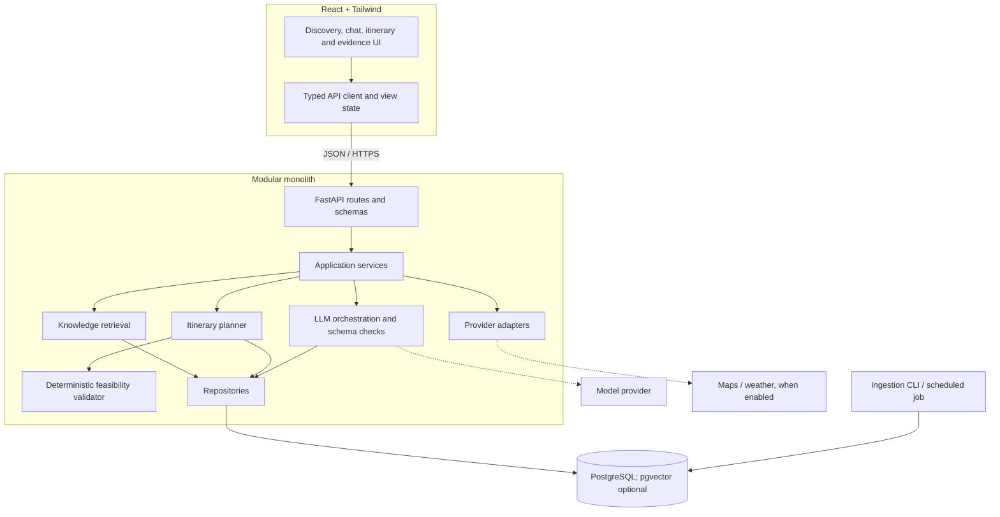

**Flow:** route handlers remain thin. Services own use cases; domain checks remain independent of the model and provider SDKs. Ingestion is operationally separate but can share domain and repository code.

### Frontend-to-backend request flow

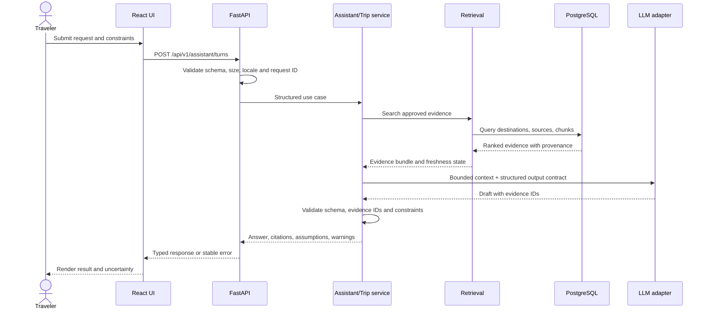

### AI and RAG data flow

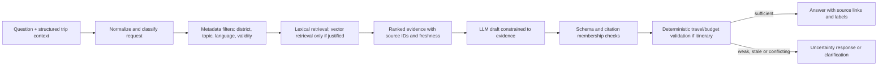

**Flow:** source quality and retrieval quality remain separate from generation quality. The model never controls authorization, numeric totals, or provider truth. If evidence fails the agreed sufficiency policy, answer with an explicit unknown or request clarification.

### Tourism knowledge ingestion pipeline

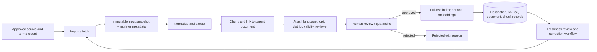

### End-to-end itinerary workflow

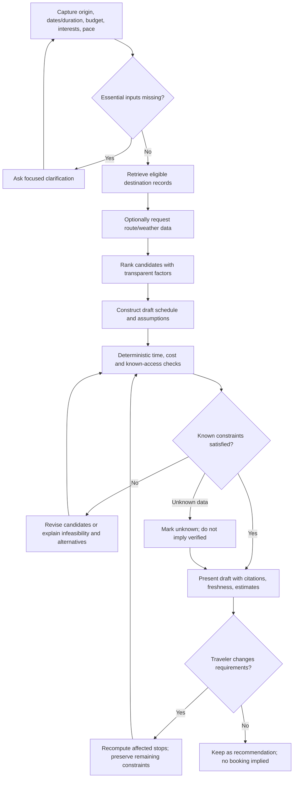

## 6. Data model and entity relationships

### Recommended first entities

| Entity | Key fields and purpose |
|---|---|
| `Destination` | Stable ID, canonical name, aliases, district/region, coordinates, categories, description, language, access notes, estimated visit duration, status |
| `Source` | ID, title, canonical URL, publisher, source type, terms/license note, trust/review status, retrieval date, last verified, validity period, reviewer |
| `DestinationSource` | Destination/source relation, supported field/claim, locator, observed date; enables field-level provenance |
| `Document` | Source ID, content hash, language, retrieval timestamp, ingestion version/status |
| `DocumentChunk` | Document ID, sequence, text, metadata, optional embedding, review status; retain exact parent source link |
| `TripRequest` | Origin, destination scope, dates/duration, budget and currency, interests, pace, party details only if needed, locale, exclusions |
| `Itinerary` / `ItineraryVersion` | Request snapshot, version, status=draft, created time, warnings and assumptions |
| `ItineraryStop` | Destination, order, day/time window, estimated duration/cost, evidence IDs, confidence/freshness, notes |
| `ProviderObservation` | Provider, subject, observation type/value, mode, retrieved/expiry time, status, attribution and raw response reference as policy permits |
| `IngestionRun` | Source/version, start/end, counts, result, failure detail, operator or job ID |
| `Feedback` | Optional user report, related destination/claim, category, created time, triage status; avoid unnecessary identity fields |

**Identity decision:** no account entity is needed for a stateless or short-lived prototype. If saved trips are approved later, add `User`, external identity subject (never raw credentials), ownership checks, data export/deletion and retention requirements before persistence.

### ER diagram

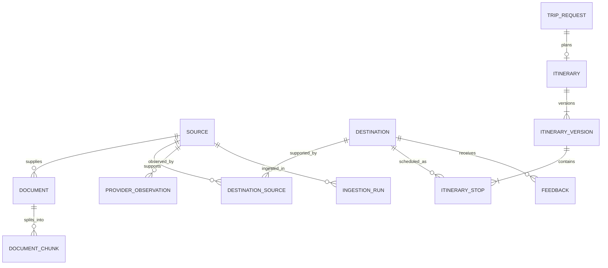

Use migrations from the first schema change. Index district/category/name/alias and source freshness fields. Use foreign keys and checks for currency, state, version ordering, and nonnegative amounts. Keep live observations separate from stable historical/cultural text. Define retention, deletion, backup encryption, and restore procedures before user data or production records are stored. pgvector is an optional extension; store model/version metadata and rebuild strategy for embeddings if adopted.

## 7. API inventory and representative contracts

All endpoints are recommendations, not documented implementations. Use `/api/v1`, JSON schemas, stable error codes, request IDs, pagination on lists, bounded request sizes, and explicit locale/currency.

| Endpoint | Purpose | MVP |
|---|---|---|
| `GET /api/v1/health/live` | Process liveness | Yes |
| `GET /api/v1/health/ready` | DB/config readiness, with dependency-safe detail | Yes |
| `GET /api/v1/destinations?district=&interest=&q=&cursor=` | Search/filter | Yes |
| `GET /api/v1/destinations/{id}` | Detail plus provenance | Yes |
| `POST /api/v1/assistant/turns` | Clarification or grounded Q&A | Yes |
| `POST /api/v1/itineraries` | Draft itinerary | Yes |
| `POST /api/v1/itineraries/{id}/revisions` | Revise current draft | Basic if state model is ready |
| `GET /api/v1/itineraries/{id}` | Retrieve trip plan | Only if persistence approved |
| `GET /api/v1/routes/estimate` | Optional route estimate | Provider-gated |
| `GET /api/v1/weather` | Optional forecast | Provider-gated |
| `POST /api/v1/feedback` | Report missing/wrong information | Recommended |

Representative itinerary request:

```json
{
  "origin": {"name": "Bhubaneswar"},
  "destination_scope": ["Puri"],
  "duration_days": 2,
  "dates": null,
  "budget": {"amount": 3000, "currency": "INR", "includes_transport_to_destination": null},
  "interests": ["temples", "beaches", "local food"],
  "pace": "moderate",
  "locale": "en"
}
```

Representative response fields (values are illustrative):

```json
{
  "status": "draft",
  "clarification_required": ["dates", "party_size", "whether accommodation is needed"],
  "stops": [],
  "budget_estimate": {"currency": "INR", "range": null, "status": "insufficient_data"},
  "constraints": {"status": "not_fully_verified", "issues": []},
  "evidence": [],
  "assumptions": [],
  "uncertainties": ["No date-specific prices or opening status were verified."],
  "provider_status": {"routes": "not_configured", "weather": "not_configured"}
}
```

Errors should distinguish `VALIDATION_ERROR`, `NOT_FOUND`, `RATE_LIMITED`, `EVIDENCE_INSUFFICIENT`, `PROVIDER_UNAVAILABLE`, `MODEL_UNAVAILABLE`, and `INTERNAL_ERROR`; never expose stack traces or secrets. For a request that lacks required information, return a successful clarification state rather than guessing.

## 8. External integrations and action boundaries

No vendor or booking capability is established in the supplied sources. Maps, weather, tourism sites, transport/status feeds, translation, lodging, activities, and reservation services must each be reviewed for coverage, terms/licensing, attribution, quotas, privacy, latency, and failure behavior. Use interfaces such as `RouteProvider`, `WeatherProvider`, and `TourismSourceAdapter`; test with deterministic fixtures/mocks, and maintain a kill switch for provider failure/cost.

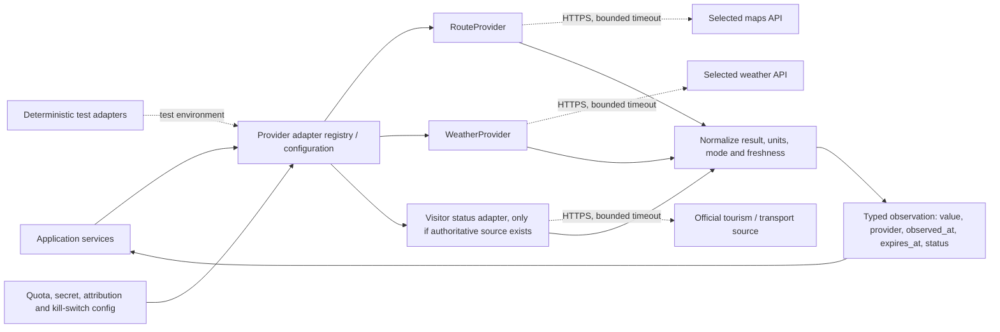

**External flow:** only the adapter knows provider-specific credentials and schemas. Application logic receives normalized observations and can distinguish a timeout, stale result, unsupported field, and valid result. No direct provider is selected until terms and access are verified.

For any future consequential action, use this state sequence:

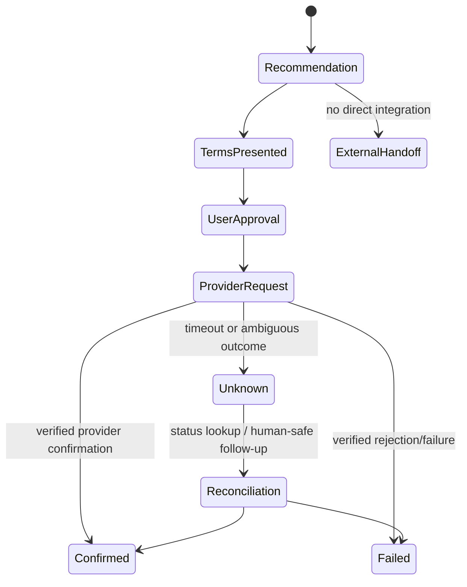

Booking and payment are **not in documented MVP scope**. If added later, persist provider request IDs and terms snapshot, require explicit user approval after presenting price/cancellation terms, use idempotency, reconcile timeouts, and mark a reservation confirmed only from verified provider evidence. A handoff link means “continue with provider,” never “booked.”

## 9. Security, privacy, trust and failure handling

- **Data minimization:** collect only trip details needed for planning. Avoid precise location unless the user supplies/consents to it for a specific action. Decide whether conversation data is transient or stored; publish retention/deletion behavior.
- **Secrets and network:** provider/model keys only in managed environment secrets; never ship them to React. Enforce TLS at deployment edge, request size limits, input/schema validation, CORS allow-list, rate limits for expensive/model routes, and outbound timeouts.
- **Authorization:** no account system is evidenced. If saved trips/accounts are later introduced, enforce owner-scoped reads/writes at the service/repository boundary and test cross-user isolation.
- **RAG/prompt injection:** treat tourism pages and user-provided content as untrusted; do not execute instructions found in retrieved material. Limit retrieved context, allow only application-defined tools, validate tool arguments, and require evidence IDs to refer to retrieved records.
- **Claim integrity:** preserve claim-to-source provenance, freshness and language; distinguish official source facts, reviewed editorial descriptions, estimates, live provider results, stale data, conflicting data, and unknowns.
- **Emergency guidance:** show only reviewed official emergency/visitor-assistance details with source and verification date. When unverified, direct users to official channels without inventing a number or status.
- **Logging:** structured logs with request ID, route, latency and outcome; redact trip/free-text and credentials by default. Restrict access and retention.
- **Failure policy:** DB unavailable → readiness false and stable error; model unavailable → offer search or a non-generated evidence list; retrieval empty → clarify/abstain; provider timeout → label unavailable; stale source → disclose or exclude according to freshness policy; infeasible plan → revise or show trade-off; malformed model output → reject and retry once only if bounded, else safe error.

### Failure and recovery workflow

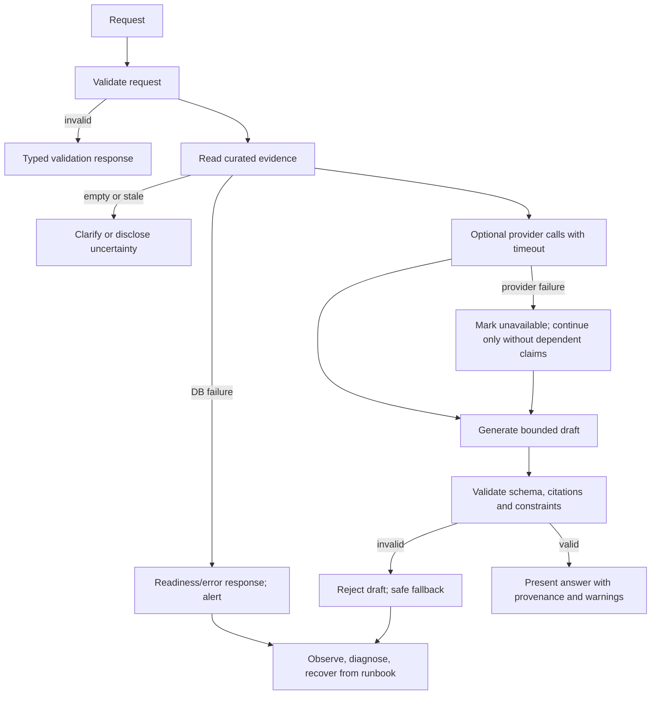

## 10. Frontend, folder structure and developer experience

**Monorepo recommended** for a small team: shared documentation and contracts make API/schema evolution easier. Keep tools and deployment simple.

```text
Yatranook/
├── apps/
│   ├── web/
│   │   ├── src/app/                 # routes, app shell
│   │   ├── src/features/discovery/  # search, filters, destination cards
│   │   ├── src/features/assistant/  # conversation and clarification UI
│   │   ├── src/features/itinerary/  # draft, schedule, constraints, revisions
│   │   ├── src/features/evidence/   # citations, freshness and uncertainty
│   │   ├── src/components/           # accessible shared UI
│   │   ├── src/lib/api/              # typed API client
│   │   ├── src/styles/
│   │   └── tests/
│   └── api/
│       ├── app/main.py
│       ├── app/api/v1/               # routes and request/response schemas
│       ├── app/core/                 # settings, logging, errors, security
│       ├── app/domain/               # entities, value objects, rules
│       ├── app/services/             # use cases
│       ├── app/repositories/         # DB access
│       ├── app/knowledge/            # ingestion, chunking, retrieval
│       ├── app/ai/                   # model adapters, prompts, output checks
│       ├── app/planning/             # ranking, schedule, constraints
│       ├── app/integrations/         # maps/weather/source adapters
│       ├── migrations/
│       └── tests/
├── packages/contracts/               # OpenAPI/types or generated client schema
├── data/                             # small reviewed seed data; no secrets/PII
├── docs/
│   ├── architecture/                 # ADRs, diagrams, threat model
│   ├── api/
│   ├── data-sources/                 # source policy and freshness schedule
│   ├── operations/                   # deploy, backup/restore, incident runbooks
│   └── evaluation/                   # datasets, protocol, dated results
├── infra/
│   ├── docker/                       # local containers only as useful
│   └── deployment/                   # chosen platform config
├── scripts/                          # import, validation, backup/restore helpers
├── .github/workflows/                # CI gates
├── .env.example                      # names and safe placeholders only
├── .gitignore
├── README.md
└── pyproject.toml / package manifests
```

Frontend pages: `/` discovery landing; `/destinations` searchable results; `/destinations/:id`; `/plan` request builder/assistant; `/itineraries/:id` only if persistence is approved. Shared components should handle empty/loading/error states and show per-fact source/freshness cues. Avoid a map as the only way to access results; provide an accessible list alternative. Keep generated plans editable and label them “draft recommendation.”

## 11. Deployment, CI/CD and operations

### Early-stage deployment shape

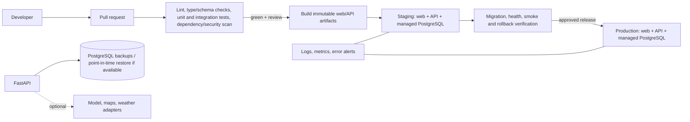

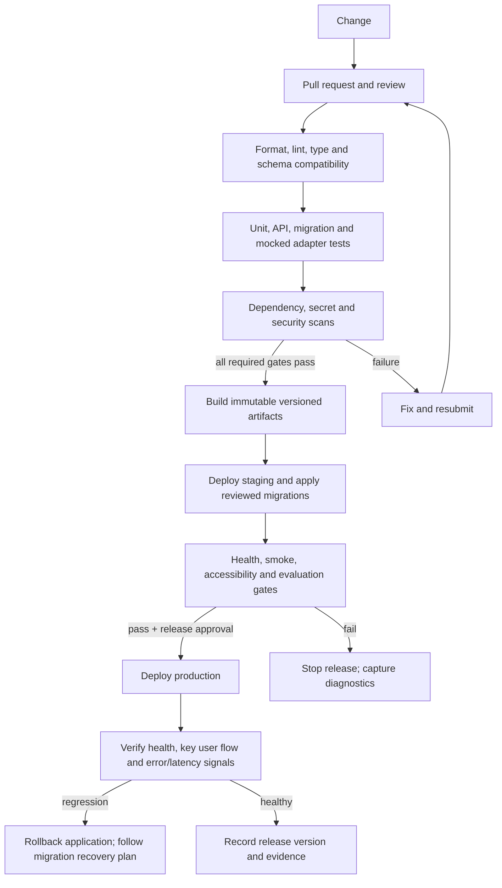

**Release flow:** no artifact moves to production unless its required checks pass. Staging exercises the same immutable build and migration sequence; smoke/evaluation failure blocks release. Application rollback and data migration recovery are separate decisions.

One containerized API and one web deployment plus managed PostgreSQL is a reasonable starting pattern, but the hosting vendor is **unverified** and should be selected based on region, cost, secrets, database backup/restore, logging, and data residency needs. Avoid Kubernetes/distributed queues initially. Run ingestion as an authenticated/manual command or scheduled job; make it idempotent and auditable.

### Environment configuration (names are recommendations)

`APP_ENV`, `LOG_LEVEL`, `DATABASE_URL`, `CORS_ORIGINS`, `PUBLIC_WEB_URL`, `MODEL_PROVIDER`, `MODEL_API_KEY`, `MODEL_NAME`, `EMBEDDING_MODEL`, `MAPS_PROVIDER`, `MAPS_API_KEY`, `WEATHER_PROVIDER`, `WEATHER_API_KEY`, `REQUEST_TIMEOUT_SECONDS`, `RATE_LIMIT_*`, `SOURCE_REFRESH_POLICY`. Do not commit real values. Use separate dev/test/staging/prod settings and least-privileged keys. Keep production source ingestion and model access separate from local/test credentials.

### Health, deployment and recovery

- Liveness reports process state; readiness checks mandatory configuration and database connectivity, not optional providers.
- Run migrations as a controlled release step with backups and forward/rollback plan; destructive schema changes need expand/contract migration sequencing.
- Capture structured request/trace IDs, API latency/error class, provider timeout/quota status, ingestion run counts, DB health, model latency/cost, retrieval misses, and evaluation drift. Avoid logging raw user content unless explicitly justified and redacted.
- Back up database and source snapshots; document retention and encryption. Before production, restore a backup into an isolated environment and verify records/indexes and application startup.
- Release using immutable build/version, staged migration and smoke checks, then rollback app version if health/regression fails. Data migrations require their own recovery plan.
- Runbooks: provider degradation, model outage/cost spike, bad ingestion/correction, DB restore, secret rotation, data deletion request, and release rollback.

### CI/CD gates (recommended)

PR: formatting/linting, type checks, schema compatibility, unit/API tests, DB migration tests, dependency/license/security scan, frontend accessibility smoke coverage, and no-secret scan. Staging: migrations, health checks, representative search/Q&A/itinerary scenario, provider mocks, and failure behavior. Production release: approved evaluation thresholds, backup restore evidence, migration/rollback plan, source policy and privacy review, and clear user-facing limitations. Do not claim CI or deployment exists until configured and run.

## 12. Testing and evaluation strategy

The following defines future tests; none were run because no application implementation is present. The user-supplied architecture prompt asks for test strategy, not implementation testing in this review.

| Category | Purpose and representative cases | Tools / measurable acceptance |
|---|---|---|
| Unit | Budget arithmetic, date/duration parsing, ranking, hard constraints, freshness policy, state transitions | Pytest and frontend unit tooling chosen with stack; all boundary/unknown cases return expected status; thresholds set before execution |
| API/schema | Required/optional fields, malformed/oversized input, pagination, typed errors, locale, clarification states | FastAPI test client/HTTP tests; response conforms to checked-in schemas; no uncaught validation detail or secret leakage |
| Database/migration | Foreign keys, provenance, transaction boundaries, migration up/down/forward recovery, indexes | Ephemeral PostgreSQL; clean DB reaches latest schema; constraints reject invalid records; restore/replay verified |
| Retrieval | Relevant destination/source chunks for normal, ambiguous, multilingual, stale/conflicting queries | Reviewed query-source set; record precision/ranking measure and threshold before run; stale/invalid sources filtered or labeled |
| Factuality/citations | Claim correctness, source support, citation presence, unsupported claims, prompt-injected source text | Human-reviewed claims; report claim count, annotation method and date; every displayed citation supports its associated claim or is flagged |
| Planning | Puri 2-day scenario, impossible budget, missing dates, route provider absent, conflicting time windows, closure unknown, revisions | Scenario matrix; hard constraints never marked satisfied when violated/unknown; totals recomputed deterministically |
| Integration | Model/map/weather adapters, timeout, quota, empty/malformed response, retry/idempotency | Mocks/recorded fixtures; bounded timeout/retry; no live paid API required in normal CI |
| End-to-end | Request → clarify → source-backed answer → itinerary → revise → map handoff where configured | Browser automation selected later; user can complete core task with sources, assumptions, warnings, and no false confirmation |
| Security/privacy | CORS/input limits, rate limit, secret exposure, log redaction, prompt injection, access isolation if accounts added | Static/dependency scan plus targeted tests; no secrets in repo/log samples; cross-user tests mandatory if saved trips exist |
| Accessibility/localization | Keyboard navigation, screen reader labels, contrast, responsive behavior, English/Odia/Hindi review if offered | Automated accessibility scan plus manual keyboard and competent language review; publish sample and failures |
| Reliability/performance | DB/provider/model interruption, slow responses, concurrent search/planning, recovery | Load test with representative traffic; set p50/p95 and error budgets before measuring; partial failure returns safe status |
| CI/CD | Required checks and release reproducibility | Branch protection/release job; only deploy successful immutable build; staging smoke and rollback evidence captured |

Evaluation metrics from the documents should include factual accuracy, citation correctness, unsupported-claim rate, recommendation relevance, itinerary constraint satisfaction, budget estimate error, travel-time error, provider resilience, median/tail latency, multilingual quality, and task satisfaction. Each result must report test set scope, sample size, annotation protocol, test date, thresholds and limitations. Do not report a number before the tests are run.

## 13. Example user journey: two-day Puri trip from Bhubaneswar

This traces a target workflow, not implemented behavior. The ₹3,000 split shown in source documents is illustrative only; it is not a quote.

| Step | UI / endpoint / service | Data and external systems | Failure/expected behavior |
|---|---|---|---|
| 1. Submit request | Trip form/chat → `POST /api/v1/itineraries` | Request contains origin Bhubaneswar, Puri, 2 days, ₹3,000, temples/beaches/food | Validate fields and currency; return clarification state for date, party size, overnight stay, and whether transit-to-Puri is inside cap |
| 2. Clarify | Assistant prompt in UI; same request flow | No persistence required unless approved | Do not quietly infer group size or included transport; user answers update structured request |
| 3. Retrieve | Planning service calls retrieval | Destination, attraction, cultural source/chunk, visit duration and provenance from PostgreSQL | If no reviewed data for a requested fact, mark unknown; show relevant records when possible |
| 4. Optional current data | Provider adapters | Route estimate for chosen mode/time; forecast for dates; no vendor is selected today | Missing key, timeout, stale response or no date → label unavailable; continue only with dependent claims removed or estimates clearly qualified |
| 5. Draft | Planner ranks candidates; LLM explains options | Ranked stops, estimated durations, evidence IDs | Model output must match schema; no invented opening hours/prices; unsupported output rejected |
| 6. Validate | Deterministic planning service | Total planned time, budget components, known time windows, route estimates | If ₹3,000 excludes unknown accommodation/transit, do not call budget feasible; show included/excluded cost categories and alternatives |
| 7. Present | Itinerary screen | Stops, duration/cost ranges only where supported, sources, last-checked times, uncertainties | Distinguish reviewed facts, live provider data, estimates and unknowns visually and accessibly |
| 8. Revise | `POST /api/v1/itineraries/{id}/revisions` if plan persisted | New constraint, existing draft version | Preserve unchanged interests/duration/budget; show changed stops and re-run validation |
| 9. Explore provider options | Provider handoff if service exists | Provider listing, official source or map direction link | No direct booking capability is established; label handoff and provider terms; do not create reservation state |
| 10. Navigate | Map link/provider route endpoint where available | Selected route/mode and retrieval time | If route cannot be verified, show place/location evidence and offer external map handoff without asserting travel time |

If date-specific price is unavailable, the system must mark that cost unknown or provide a clearly labeled estimate only if its basis is documented. If budget is exceeded, revise or show the trade-off. If a route provider times out, remove provider-dependent feasibility claims. If booking confirmation is ever indeterminate, retain an `unknown/pending reconciliation` state and do not label it confirmed.

## 14. Roadmap, scope and risk controls

### Phase roadmap

| Phase | Objective and sequence | Main folders / verification | Definition of done / recovery |
|---|---|---|---|
| 0. Research and architecture | Validate traveler pain, choose first segment, set MVP, curate source policy, clarify persistence/provider choices, record ADRs | `docs/architecture`, `docs/data-sources`, `docs/evaluation`; interview/observed task plan and reviewed requirements | Scope and thresholds approved; assumptions and risks explicit. If user evidence contradicts concept, revise scope before coding |
| 1. Repository foundation | Create monorepo, frontend/API shells, config, local README, CI skeleton | `apps/web`, `apps/api`, `packages/contracts`; clean setup in a fresh checkout | Reproducible local startup with safe sample config and initial CI; no real secrets/data committed |
| 2. Data and discovery | Design migration, import small reviewed destination set, provenance, search/filter API and UI | `apps/api/app/domain`, `repositories`, `knowledge`, `migrations`, `data/` | Search returns traceable curated records; run import twice safely; rollback/restore documented |
| 3. Grounded assistant | Retrieval, model adapter, prompt/version, citations, uncertainty, clarification and evaluation set | `apps/api/app/ai`, `knowledge`, `tests`; UI assistant/evidence components | Reviewed cases pass predeclared quality gates; weak/empty evidence safely abstains |
| 4. Itinerary and revision | Structured inputs, scoring, schedule creation, cost/time validators, alternatives, revision flow | `apps/api/app/planning`, `services`; itinerary UI | Scenario matrix shows no known hard-constraint violation labeled feasible; estimates/unknowns visible |
| 5. Selected live integrations | Select only validated map/weather providers; adapter contract, timeouts, quotas, attribution, freshness | `apps/api/app/integrations`; provider mocks and feature switches | Provider outages do not break core product; terms/access and data limits reviewed; otherwise defer |
| 6. Production baseline | Security/privacy, logging, metrics, rate limits, backup/restore, deployment, CI gates, accessibility | `infra`, `docs/operations`, `.github/workflows` | Clean staging deployment, restore drill, migration/rollback rehearsal, health and incident runbooks complete |
| 7. Pilot and iteration | Limited pilot, support feedback, measure task success and quality, fix evidence/data gaps | `docs/evaluation`, feedback workflow, operations dashboard | Dated report includes sample, method, failures and limitations; expansion decisions based on user value and operations |

No date estimates are reliable without team size, skills, data scope, and provider access. Avoid declaring a phase complete based on files alone; require its verification evidence.

### MVP / production baseline / later

- **MVP:** small reviewed Odisha destination dataset; destination discovery; English web interface; grounded Q&A; clarification when essential inputs are missing; draft itinerary; deterministic budget/time checks; visible source, freshness, assumptions and unknowns; graceful no-provider behavior; lightweight feedback.
- **Production baseline:** security/privacy review; safe configuration/secrets; schema migrations; rate limiting for costly endpoints; structured/redacted logs; monitoring/error handling; quality evaluation with predeclared thresholds; responsive/accessibility validation; tested provider failures; backups and demonstrated restore; deployment/rollback runbooks and support ownership.
- **Later after validation:** broader data coverage, Odia/Hindi after human review, maps/weather integrations, saved trips/accounts, accessibility-aware planning, festivals/alerts, collaboration, local listings, voice, advanced route optimization, reservations/payments. Each requires explicit value, data rights, operational and privacy assessment.

### Prioritized risk register

| Risk | Likelihood / impact | Mitigation and detection | Owner |
|---|---|---|---|
| Incomplete/stale tourism data | High / High | Provenance, validity dates, freshness queue, coverage checks; detect stale/missing source share and user reports | Data curator |
| AI misinformation or false citation | Medium-High / High | Bounded retrieval, structured evidence IDs, abstention, reviewed factuality/citation set; monitor unsupported-claim rate | AI/backend lead |
| Unrealistic schedule | Medium / High | Deterministic duration/route checks, unknown state, scenario tests; measure hard-constraint pass rate | Planning lead |
| Inaccurate cost estimate | High / High | No fabricated/live quote; include cost categories, ranges and exclusions; compare to observed quotes only when comparable | Product/data lead |
| Provider/API access, quota, cost | Medium / Medium-High | Vendor review, adapter, quotas/timeouts/kill switch, mocks; monitor errors and spend | Integration owner |
| Unauthorized action / false booking status | Low in MVP / High if booking | Exclude transactions initially; if added, approval, idempotency and provider verification state machine | Product/security |
| Privacy/secret exposure | Medium / High | Minimize data, secrets management, redacted logs, retention/deletion, access review; scan and incident checks | Security/operations |
| Bad ingestion or migration/data loss | Medium / High | Idempotent runs, review/quarantine, migration discipline, backups and restore drill | Data/operations |
| Language/cultural error | Medium / High | Human review of place names and cultural content; language-specific evaluations and correction process | Content/localization lead |
| Scope expansion beyond team | High / Medium-High | Gate features on research and data readiness; phase exit criteria and explicit deferrals | Product owner |
| Accessibility/usability failure | Medium / Medium | Keyboard/screen-reader/responsive review; observed user tasks and issue tracking | Frontend/product |

### Recommended ADRs

| ADR | Recommendation / rationale | Trade-off and revisit when |
|---|---|---|
| 001 — Modular monolith | One API deployment with internal modules fits early scale and limited ops | Less independent scaling; revisit with measured bottlenecks or team ownership boundaries |
| 002 — Stateless-first trip context | Avoid account/privacy burden until saved trips are validated | Less cross-device persistence; revisit if user research shows repeated/saved planning need |
| 003 — PostgreSQL before vector search | Relational source/destination data and text search minimize complexity | Semantic retrieval may improve discovery; add pgvector when a benchmark demonstrates value |
| 004 — Provider adapters, optional by default | Core workflow remains useful during outages and before vendor access | Less live data initially; enable provider only after terms/coverage/cost review |
| 005 — Deterministic feasibility and cost arithmetic | Reliable hard constraints must not depend on LLM fluency | More domain rules to maintain; revisit only with evidence that rules cannot express a required soft preference |
| 006 — No direct booking in MVP | No provider capability or user requirement established | User leaves app to transact; revisit with authorized provider contract, approval, reconciliation and support design |
| 007 — Provenance as first-class data | Every fact/claim needs traceability and freshness | More curation work; simplify only for content proven not to affect traveler decisions |

## 15. Final production-readiness checklist

An item is not complete until evidence is recorded.

- [ ] User problem and first target segment validated with observed planning tasks.
- [ ] MVP, user-facing terminology and Yatranook name standardized.
- [ ] Tourism sources, access terms, source quality, attribution, freshness and reviewer ownership documented.
- [ ] Destination records have provenance and an update/correction path.
- [ ] API schemas and error states are versioned and documented.
- [ ] Model/provider choices, data handling, cost limits and fallback behavior are documented.
- [ ] RAG factuality/citation and itinerary constraint thresholds are set before evaluation; results have date/sample/method/limitations.
- [ ] Unknown, stale, conflicting and unavailable data have visible UI behavior.
- [ ] Arithmetic, authorization, provider status and schedule constraints are deterministic and tested.
- [ ] Data retention, deletion, logging redaction, secrets, rate limits and threat model are reviewed.
- [ ] Accessibility/responsive behavior and each offered language have appropriate human review.
- [ ] Provider contract/terms/quotas/attribution have been checked for each enabled integration.
- [ ] CI quality gates run on the exact release build; no credentials or personal data are committed.
- [ ] Database migrations, backup, isolated restore, and application recovery have been demonstrated.
- [ ] Staging deployment, health checks, alerting, runbooks and rollback have been exercised.
- [ ] User-facing copy distinguishes recommendation, estimate, verified/live provider data, and unknown.
- [ ] No booking or payment is represented as confirmed without verifiable provider confirmation.
- [ ] Pilot support and feedback triage have an owner; expansion is evidence-based.

## Source notes

Primary evidence references: `Yatranook_Supporting_Document.pdf` pp. 1–14 (especially pp. 5–12 for requirements, architecture, workflow, RAG, data, integrations, roadmap and evaluation); `Yatranook_Abstract.pdf` pp. 1–17 (especially pp. 7–16 for capabilities, workflow, architecture, trust, proposed stack, roadmap and evaluation); `Yatranook_Architecture.png` (conceptual A–H layered diagram). The sources list Odisha Tourism and UNESCO references on Supporting Document p. 14; those external pages were not independently verified as current in this architecture review and must be checked before ingesting or serving travel advice.

