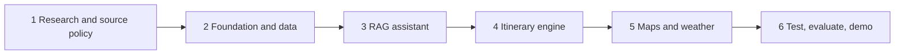
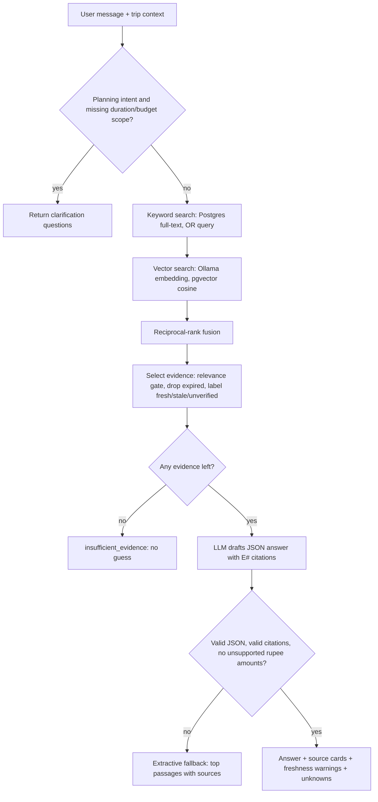

# Yatranook: project workflow and RAG workflow

Status of this document: design plus the code in `apps/api/app/rag/`. Only the pure-logic parts
(chunking, guard, retrieval fusion, planner) have been run in tests. DB queries, Ollama calls and
the FastAPI router are written but **not yet run against your stack**.

## 1. Project workflow (build order)

| Phase | What to do | Done when |
|---|---|---|
| 1 Research | Pick pilot region (e.g. Puri + Bhubaneswar), list allowed sources, name a reviewer | Source allowlist written |
| 2 Foundation | Compose stack, migrations, destination list/detail API, seed data | `docker compose ... up` loads data and search works |
| 3 RAG | Apply `rag_tables` migration, ingest JSONL, approve sources, `/assistant/turns` | Eval set passes thresholds you set beforehand |
| 4 Itinerary | `/assistant/itinerary`, deterministic checks, revision via `pin`/`exclude` | No violated hard constraint is shown as feasible |
| 5 Live APIs | OSRM route adapter, weather adapter, behind timeouts | Provider outage does not break core flow |
| 6 Evaluation | Run `scripts/eval_rag.py`, user test, write dated report | Report lists sample, method, failures |

## 2. Runtime workflow (one request)

Itinerary requests follow the same retrieval, then `planner.build_plan` (deterministic scoring, packing,
checks), then an optional LLM overview that is validated the same way. The LLM never produces times or totals.

## 3. Ingestion workflow

`JSONL -> injection scan (quarantine) -> sentence chunking -> embeddings (nomic, zero-padded to 1536) -> insert, idempotent by content hash -> status 'pending' -> human --approve -> served`

Unapproved sources are never served unless `RAG_ALLOW_UNREVIEWED=true` (dev only).

## 4. Design decisions worth explaining in your report

- **Hybrid retrieval** (keyword + vector, fused with RRF) because tourism queries mix proper nouns ("Hathigumpha") that vectors miss with paraphrases that keywords miss.
- **Zero-padding 768 -> 1536**: cosine similarity is unchanged, so `nomic-embed-text` fits the existing `vector(1536)` column without a migration.
- **Abstain over guess**: no evidence means no LLM call.
- **Citation membership check**: the model can only cite ids it was given; an answer with a rupee amount absent from the evidence is rejected.
- **Prompt-injection handling**: instruction-like text is quarantined at ingest, angle brackets are neutralised in prompts, and evidence is declared untrusted data.
- **Deterministic feasibility**: statuses `pass | warning | fail | unknown`; missing travel time, hours or prices stay `unknown`.

## 5. Known limitations

- Full-text search uses the `english` configuration; Odia/Hindi need a different config or vector-only retrieval.
- No road-route provider yet, so travel time is always `unknown`.
- Seed visit durations are editorial estimates; the seed facts are unreviewed and have no `last_verified` date, so they show as `unverified`.
- `qwen2.5-coder:3b` (your current default) is a code model; `llama3.2:3b` or `qwen2.5:3b-instruct` should follow the JSON/citation format better. Compare them in the eval.
- Small models can still ignore the citation rule; the validator then falls back to extractive passages.

## 6. Evaluation protocol

Before running `scripts/eval_rag.py`, write down thresholds (for example hit@k, abstention rate, zero rupee leaks).
Then report n, date, models, failures and limitations. Answer quality (claim supported by cited source) needs human review.
